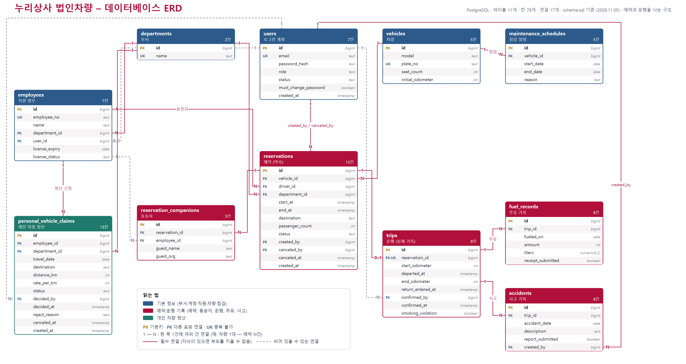

# 누리상사 법인차량 예약·운행 관리 웹앱 – 과제 보고서

작성자: 구금미 | 작성일: 2026.11.05 | Next.js(코어 웹·어드민) · NestJS(백엔드) · PostgreSQL(DB) · Dify(누리 안내봇) · Vercel / Render 배포 | 모든 데이터는 가상 데이터

---

## 1. 고객과 주제

**주제:** 회사 법인차량(3대)을 빌리고 돌려받는 일을 규정대로 지켜 주는 예약·운행 관리. **고객:** 누리상사 총무팀.

지금은 직원이 말로 부탁하고 총무팀이 종이·메모로 일정을 적어요. 그래서 같은 차가 겹쳐 잡히고, 면허가 없는 직원이 빌리고, 주행거리가 앞뒤가 안 맞고, 부서별 이용량을 아무도 몰라요. 이 과제는 "예약 앱"이 아니라 **"규정을 지켜 주는 장부"** 를 만드는 것으로 잡았어요.

| 화면 | 쓰는 사람 | 하는 일 |
|---|---|---|
| 코어 웹 | 임직원(고객) | 가입·로그인, 자기 예약만 보고 신청·취소, 출발·반납·주유 기록 |
| 어드민 | 총무팀(관리자·일반 직원) | 전체 예약 보기, 반납 확인, 면허 승인, 계정 관리(관리자만), 현황·통계 |

## 2. 고객의 요청과 진짜 문제

| 고객의 말 | 진짜 문제 |
|---|---|
| 같은 차가 겹쳐서 잡혀요 | 겹침을 사람이 기억으로 확인한다. 서버가 막아 주지 않는다 |
| 7명인데 5인승을 잡아요 | 차 정보(좌석 수)와 신청이 연결되어 있지 않다 |
| 도착 주행거리가 출발보다 작게 적혀요 | 출발 거리를 사람이 직접 적어서 앞뒤가 이어지지 않는다 |
| 면허 없는 직원이 빌려 가요 / 면허가 만료된 직원도 걸러야 해요 | 직원의 면허 상태가 예약 확인에 쓰이지 않는다 |
| 점검 날에도 예약이 돼요 | 점검 일정과 예약이 따로 놀고 있다 |
| 부서별로 얼마나 쓰는지, 차마다 기름값이 얼마인지 몰라요 | 운행·주유가 숫자로 쌓이지 않아 모아 볼 수 없다 |
| 안 돌아온 차를 바로 알고 싶어요 | 반납 예정과 실제 반납을 비교해 주는 곳이 없다 |
| 같이 탄 사람을 적어 두면 좋겠어요 | 동승자가 기록되지 않는다 |

**다시 물어본 것:** 고객에게 업무 규칙 질문 19개(Q1~Q19)와 데이터 설계 질문 12개(DQ1~DQ12)를 다시 물어 답을 받아 규칙을 정했어요(기획서 13장). 처음 요청 12개를 합치면 모든 규칙이 고객 답변이 근거예요.

**차별화 방안 (세 가지)**
1. **고칠 수 없는 운행 기록:** 출발 주행거리는 직전 반납의 도착 거리가 자동으로 들어가 직원이 못 고쳐요. 도착이 출발보다 작거나 같으면 저장되지 않고, 500km를 넘게 크면 경고 뒤 총무팀이 확인해요.
2. **유류비 정산:** 한 번 운행에 주유를 여러 번 기록하고 차량별 월 주유비·운행 거리·1km당 주유비를 보여 줘요. 개인 차량은 1km당 200원으로 자동 계산해 신청 → 총무팀 승인까지 해요.
3. **규정을 요구사항으로 삼아 개발:** 규정 문서의 조건(하루 전, 3일, 면허, 좌석, 30분 여유 등)을 서버가 똑같이 검사해요. 규정을 어기는 신청은 저장 단계에서 거절돼요.

## 3. 필수 기능 대조표

| 구분 | 필수 기능 | 구현 내용 | 완료 |
|---|---|---|---|
| 공통 | 이메일·비밀번호 가입·로그인, 이메일 중복 불가, 비밀번호 해시 저장 | 가입은 직원 명부의 사번·이름으로 본인 확인, 로그인(JWT 8시간) | ✔ |
| 공통 | 고객은 자기 것만, 직원은 어드민에서 전체 | 서버가 로그인 정보로 역할을 확인해 거절 | ✔ |
| 공통 | 직원 계정은 관리자가 생성·수정·정지, 비밀번호 리셋(임시 비밀번호, 다음 로그인 때 변경) | 어드민 계정 관리(관리자만) | ✔ |
| A | 차량(차량 번호 중복 불가)·직원(면허)·점검 일정 | 테이블 `vehicles`, `employees`, `maintenance_schedules` | ✔ |
| B | 예약, 동승자 여러 명, 겹침·3일·면허·좌석·점검 규칙 | 서버와 DB가 함께 검사 (7장 참고) | ✔ |
| B | 상태(예약됨·운행 중·확인 대기·반납·취소), 반납 확인자·시각 | `reservations.status`, `trips.confirmed_by·at` | ✔ |
| B | 출발·도착 주행거리(도착 > 출발), 주유 여러 번 | `trips`, `fuel_records` | ✔ |
| C | 차량별 월 운행 거리·주유비, 부서별 이용 횟수·거리, 미반납 목록 | 어드민 통계·미반납 화면 | ✔ |
| D(5개 중 하나 이상) | 현황표, 1km당 주유비, 면허 만료 30일 목록, 사고 기록 | 4개 구현. 직원별 이용 이력은 별도 메뉴 없이 예약 목록의 운전자 검색·상태·차량·부서·기간 필터로 확인 | ✔ |
| 선택 | 규정 챗봇 | 누리 안내봇 (6장) | ✔ |

## 4. 데이터 설계(ERD)와 설계 이유

테이블은 11개예요. 같은 DB(`hw2`) 안에 표만 나눈 거예요.
- 기본 정보 5개: 부서, 로그인 계정, 직원 명부, 차량, 점검 일정
- 예약·운행 기록 5개: 예약, 동승자, 운행, 주유 기록, 사고 기록
- 정산 1개: 개인 차량 정산

**설계 이유 (세 가지)**
1. **같은 내용은 한 곳에만 적어요.** 부서는 별도 표로 두고 고르게 해서, 이름을 직접 쓰다 다르게 적히는 일(예: "개발팀"과 "개발 팀")을 막아요. 예약할 때의 부서는 예약에 복사해 두어, 직원이 부서를 옮겨도 지난 통계가 바뀌지 않아요.
2. **예약(약속)과 운행(실제로 나간 기록)을 나눴어요.** 출발하지 않은 예약에는 주유·사고를 붙일 수 없고, 예약 표에서 상태에 따라 비는 칸이 8개에서 2개로 줄어요. 처음엔 예약 표 하나에 다 넣었다가(A안) 둘로 나눴어요(D안, 표 9개 → 11개). 변경 전 문서는 `변경전_A안/`에 보관했어요.
3. **규칙은 서버와 DB가 함께 지켜요.** 한 줄 안의 값(끝 > 시작, 금액 > 0), 중복(`UNIQUE`), 시간 겹침(`EXCLUDE`)은 DB가 막고, 여러 표를 비교하는 규칙(면허, 좌석, 점검 기간)은 서버가 막아요. 계산으로 구할 수 있는 값(운행 거리 = 도착 − 출발)은 따로 저장하지 않아서, 원본을 고쳐도 어긋나지 않아요.

## 5. 웹앱 화면

**주소:** 코어 웹 https://rental-web-one-puce.vercel.app · 어드민 https://rental-admin-nine.vercel.app

| 화면 | 내용 | 캡처 |
|---|---|---|
| 회원가입 | 직원 명부의 사번·이름으로 본인 확인 | `발표자료/캡처/web_00_signup.png` |
| 로그인 | 이메일·비밀번호 (코어 웹, 어드민) | `web_01_login.png`, `admin_01_login.png` |
| 직원 계정 관리·비밀번호 리셋 | 관리자가 계정 생성·정지, 임시 비밀번호 발급 | `admin_06_accounts.png` |
| 주요 화면 | 예약 신청, 예약 상세·출발·반납, 어드민 홈(오늘 할 일), 예약 현황표, 반납 확인, 통계 | `web_03_reserve.png`, `web_05_detail.png`, `admin_02_home.png` 외 |
| 백엔드가 거절한 화면 | 규칙을 어기면 서버가 이유를 알려 주며 거절 | `web_06_rejected.png` |
| DBeaver에서 DB가 거절한 화면 | 서버를 거치지 않고 DB에 직접 넣어도 끝 시각이 시작보다 빠르거나 같은 차량 시간이 겹치면 DB가 거절 | `dbeaver_reject.png`, `dbeaver_overlap.png` |

예약은 승인 없이 규칙만 통과하면 바로 확정돼요. 승인은 면허(총무팀 승인), 반납 확인, 개인 차량 정산에만 있어요.

## 6. (선택) 누리 안내봇 — 규정 질문 챗봇

**무엇을 하나요?** 코어 웹의 "규정 묻기"에서 규정 3개(차량 이용·유류비 정산·사고 처리) 문서만 근거로 답하고, 근거 조항 번호(예: [V-4])를 함께 적어요. 문서에 없으면 "규정에 없어요. 총무팀에 문의해 주세요"라고 답해요. Dify에 규정을 올려 만들었고, 웹앱은 백엔드를 거쳐 호출해요(챗봇 열쇠를 서버에만 두기 위해서예요).

**검색 실험 (Dify 검색 테스트로 측정, 질문 8개)**

| 검색 방식 | 정답 조항을 찾은 수 |
|---|---|
| 벡터 + 재랭크 | 5/8 |
| 벡터(재랭크 없음) | 5/8 |
| 전체 텍스트(키워드) | 1/8 |
| 하이브리드 + 재랭크 | 6/8 |

Top K(3→10)를 키우면 5문항 중 2개에서 4개로 늘었어요.

**틀린 답과 고친 것:** "앞 예약이 끝나고 바로 다음 예약을 잡을 수 있어요?"에 "규정에 없어요"라고 답했어요. 규정에는 [V-4]가 있었는데 챗봇이 그 조항을 찾지 못한 경우예요. 질문의 말과 규정의 말이 달라서로 보여요(직접 확인한 것은 아니에요). [V-4] 조항 끝에 쉬운 말 한 줄을 덧붙여 다시 올렸고, 규정 내용은 바꾸지 않았어요. 고친 뒤 질문 7개 모두 규정에 맞게 답했어요.

**확인하지 않은 것:** 검색 단계만 시험했고, 운영 앱의 검색 설정(검색 방식·Top K)은 열어 확인하지 않았어요. 질문 수가 적어서 전체 정확도로 말하기는 어려워요.

## 7. 추가 사항 (필수 기능 이외)

- **기획서의 추가 기능 17개**
  - 기록 정확성: 출발 거리 자동 입력, 500km 초과 경고, 직원은 출발 거리 수정 불가
  - 규정 반영: 반납 후 30분 여유, 흡연 위반 표시, 사고 보고서 3일 기한 초과 표시
  - 안전한 이용: 면허 승인 절차, 면허 만료 예약 표시, 같은 운전자 시간 겹침 금지
  - 관리: 임시 비밀번호·정지 계정 처리, 예약 당시 부서 복사 저장, 영수증 제출 표시
  - 사용: 직원 명부 사번 가입, 외부 손님 동승자 기록, 누리 안내봇
- 개인 차량 정산(1km당 200원): 신청 → 승인·반려
- 가상 데이터 다시 채우기 버튼(관리자)
- 이용 가이드(앱용·어드민용) 문서와 메뉴 구조도
- **테스트:** 규칙 107 · 보안 36 · 화면 86개 통과, 실패 0
- **배포:** 서버·DB는 Render, 화면 2개는 Vercel, GitHub 저장소 3개(web·admin·backend)

## 8. 저장소와 배포 주소

| 구분 | 코어 웹 | 어드민 | 백엔드 |
|---|---|---|---|
| GitHub 저장소 | github.com/midayo13-droid/Rental-web | github.com/midayo13-droid/Rental-admin | github.com/midayo13-droid/Rental-backend |
| 배포 주소 | rental-web-one-puce.vercel.app (Vercel) | rental-admin-nine.vercel.app (Vercel) | rental-backend-r63r.onrender.com (Render) |

**확인용 계정(가상):** 고객 `customer01@nuri.test` · 총무팀 관리자 `admin@nuri.test` · 총무팀 일반 직원 `staff1@nuri.test` (비밀번호는 Rental-web README에 적어 둠).

※ 백엔드는 무료 서버라 한동안 쓰지 않으면 잠들어, 첫 접속이 30~60초 느릴 수 있어요. 무료 DB는 2026년 11월 25일에 만료돼요. DB 주소·API 키 같은 비밀값은 서버 설정에만 있고 GitHub에는 없어요.

## 9. 어려웠던 점, 배운 점, 현재 문제점과 다음에 할 일

**어려웠던 점과 해결**
- **겹침과 시간 규칙을 DB가 지키게 하기:** 같은 차량의 이용 시간이 겹치는 것(앞 예약이 끝난 뒤 30분 여유 포함)을 DB의 `EXCLUDE` 제약으로 막았어요. DBeaver에서 DB에 직접 넣어도 거절되는 것을 확인했어요.
- **챗봇이 규정에 있는 내용을 못 찾음:** 위 6장처럼 조항 끝에 쉬운 말 한 줄을 덧붙여 해결했어요.
- **멀리 있는 DB가 느림:** 서로 상관없는 조회를 한꺼번에 보내 응답 시간을 줄였어요.

**배운 점**
- 처음 해 보는 일도 순서대로 하면 된다는 걸 배웠어요: 규정 → 기획서 → DB 설계 → 구현 → 배포, 단계마다 확인했어요.
- DB에 대해 짧게나마 공부했어요.
- AI 활용이 많아졌어요.
  - 챗봇을 등록할 때 임베딩이 안 되는 이유를 AI와 함께 찾아 해결했어요.
  - "예측하지 말라"고 해도 AI가 예측해서 답하는 경우가 많았어요. 꼼꼼한 확인이 필요해요.
  - 이번엔 AI에 많은 걸 맡겼더니 빠르고 편한 쪽만 선택해서 아쉬운 부분이 많았어요.

**현재 문제점**
- 출발 거리는 직전 도착 값을 그대로 써요: 앞 사람이 틀리게 쓰면 다음 운행 거리도 어긋나요.
- 예약 사이에 차가 움직여도 알 수 없어요.
- 도착 거리를 고치는 화면이 없고, 계기판과 대조할 방법도 없어요.
- 시간을 고를 때가 아니라 "예약하기"를 눌러야 겹침을 알려 줘요.
- AI를 어디까지 믿을 수 있는지 판단하기 어려워요.

**다음에 할 일**
- 운행의 정확성을 위해 계기판 사진 + AI 숫자 대조(AI가 읽고 총무팀이 최종 확인) 또는 차량 GPS 연동(직원 폰이 아니라 차량 장치로, 거리를 계기판과 비교)을 고도화해요.
- 도착 거리 수정(이력 남김), 시간 고를 때 겹침 바로 알려 주기
- 직원별 이용 이력 전용 화면, 메일·문자 알림(출발 안내, 미반납·면허 만료·사고 보고서 기한), 긴급 예약 승인
- 이 밖에 영수증·사고 사진 저장, 청소비 자동 계산, 챗봇의 예약 대행, 개인 차량 정산의 실제 지급 처리

사진·AI와 GPS는 아직 만들지 않았고 방향만 정리했어요.
